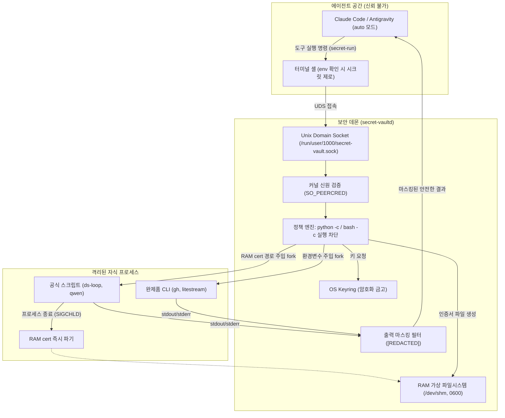
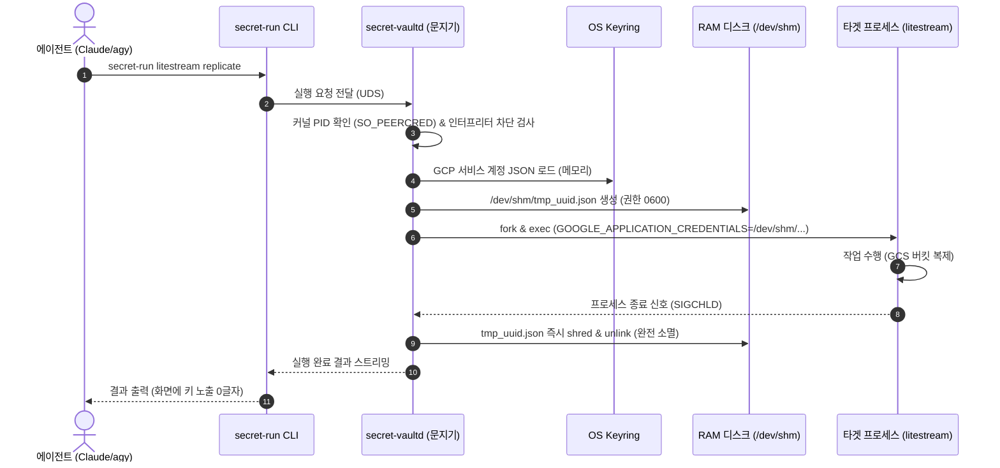
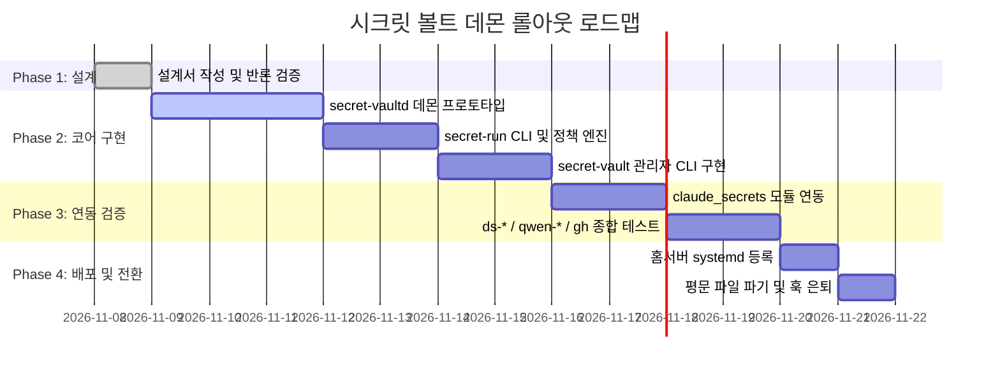

# 《에이전트로부터 시크릿을 지키는 법》
### : 인간 개발자가 AI의 탁상공론을 박살 낸 7번의 대화와 최종 아키텍처 완전판

> **부제**: 자율 AI 에이전트 시대의 로컬 시크릿 방어술과 엔지니어링 청사진  
> **저자**: 사용자(Human Architect) & Antigravity(AI Pair Programmer)  
> **발행일**: 2026년 11월 8일  
> **문서 버전**: v2.1 (Complete Edition with Lifecycle & Agent Protocol)  

---

## 📚 목차

- **서문: 왜 이 책을 쓰는가?**
- **제1부: 격돌의 기록 (7번의 대화와 맹점의 극복)**
  - 프롤로그: "지연시간 때문에 안 하기로 했었잖아"
  - 제1장: 평문 파일 하나를 지키기 위해 세운 수많은 성벽
  - 제2장: 첫 번째 반론 — "파일 이름을 똑같이 지으면 뚫리는 거 아냐?"
  - 제3장: 두 번째 반론 — "우리 스크립트가 몇 개인지 알아?"
  - 제4장: 세 번째 반론 — "나는 auto 모드로 돌리는데?"
  - 제5장: 네 번째 반론 — "우리가 쓰는 게 웹 API뿐인 줄 알아?"
  - 제6장: 다섯 번째 반론과 결정타 — "cert도 주입해서 쓸 텐데?"
  - 제7장: 대통합 — 시련을 딛고 완성된 아키텍처
- **제2부: 최종 아키텍처 엔지니어링 청사진**
  - 제8장: 시스템 컴포넌트 및 데이터 흐름도
  - 제9장: 2대 주입 엔진 (환경변수 vs RAM 가상 파일 `/dev/shm`)
  - 제10장: 러너(`secret-run`) 방어 정책 및 커널 신원 검증
  - 제11장: 공용 모듈(`claude_secrets.py`) 하위 호환성 명세
  - 제12장: 미래를 위한 확장: 키 라이프사이클 관리 (`secret-vault`)
  - 제13장: 에이전트-사용자 인터랙션 프로토콜 (Missing Secret Card)
  - 제14장: 단계별 구현 및 롤아웃 로드맵
- **에필로그: 자율 에이전트 시대, 인간과 AI의 진짜 협업**

---

# 서문: 왜 이 책을 쓰는가?

2026년, 자율 코딩 에이전트(Autonomous Coding Agent)는 더 이상 공상과학이 아니다. Claude Code, Antigravity 같은 에이전트들은 이제 터미널 셸 권한을 쥐고 스스로 코드를 분석하며, 파일을 수정하고, 심지어 Git 커밋과 PR까지 사람의 개입 없이 `auto 모드`로 처리한다.

하지만 에이전트의 자율성이 커질수록, 엔지니어링 팀은 전례 없는 보안 딜레마에 부딪힌다:
> **"에이전트에게 셸 권한과 파일 쓰기 권한을 주면서, 어떻게 시스템의 비밀번호(시크릿)는 에이전트의 눈으로부터 완벽히 감출 것인가?"**

이 책은 로컬 환경에서 시크릿을 다루며 마주친 수많은 맹점과 오탐, 그리고 인간 개발자가 던진 5번의 날카로운 실전 반론을 통해 AI의 탁상공론이 실전 아키텍처로 진화해 나간 치열한 기록이자 완성된 엔지니어링 청사진이다.

---

# 제1부: 격돌의 기록 (7번의 대화와 맹점의 극복)

```
                     [ AI의 이론적 아이디어 ]
                                │
                 (1차 반론) "파일명 같으면 뚫리잖아?" ──▶ [창구 분리: GET vs RUN]
                                │
                 (2차 반론) "우리 스크립트가 몇 개인데?" ──▶ [해시 지옥 탈출]
                                │
                 (3차 반론) "auto 모드라 커밋도 지가 해" ──▶ [Git 검증의 허상 격파]
                                │
                 (4차 반론) "gh 같은 CLI는 어쩔 건데?" ──▶ [바이너리 러너 도입]
                                │
                 (5차 반론) "cert(인증서)도 주입해야지" ──▶ [RAM 가상 디스크 /dev/shm]
                                │
                                ▼
                     [ 최종 실전 아키텍처 완성 ]
```

### 프롤로그: "지연시간 때문에 안 하기로 했었잖아"

어느 늦은 밤, 대화는 짧은 회상 하나로 시작되었다.

> **인간**: "우리 예전에 구글 클라우드에 시크릿 모으는 거 논의한 적이 있는데, 지연시간 및 네트워크 때문에 안 하기로 했었어."

수많은 엔터프라이즈가 클라우드 시크릿 매니저(GCP Secret Manager, AWS Secrets Manager, HashiCorp Vault)를 쓴다. 보안의 정석처럼 여겨지기 때문이다. 하지만 로컬에서 초당 수십 번씩 스크립트를 띄우고, 백그라운드 크론을 돌리고, 오프라인 환경에서도 작업해야 하는 개발자에게 클라우드 API 호출의 왕복 시간(RTT 수십~수백 ms)과 네트워크 의존성은 치명적이다. 

그래서 우리는 시크릿을 로컬 파일(`claude-secrets.json`)에 두고 관리하기로 했었다. 

하지만 그 선택은 또 다른 괴물을 낳았다. 바로 **"가드 훅(Guard Hooks)의 지옥"**이었다.

---

### 제1장: 평문 파일 하나를 지키기 위해 세운 수많은 성벽

> **인간**: "맞아 목적은 그거야. 지금은 수많은 훅으로 평문 파일 노출을 막고 있는데, 로컬에 띄우면 이걸 해소할 수 있을까 싶어서."

디스크에 평문 비밀번호가 적힌 JSON 파일이 상시 존재한다는 것은, 언제든 눈먼 에이전트(LLM)가 그 파일을 읽어 콘솔에 뿌릴 수 있다는 뜻이다.

이를 막기 위해 우리는 방어벽을 세우기 시작했다:
- 에이전트가 `cat`, `type`, `Get-Content`로 그 파일을 열지 못하게 감시하는 Pre-tool 훅.
- 터미널 명령어에 파일명이 들어가는 순간 실행을 튕겨내는 명령어 파서 훅.
- 스크립트 코드나 Git 커밋 diff에 키 패턴이 보이면 중단시키는 사후 훅.

하지만 훅이 늘어날수록 **오탐(False Positive)**이 개발자를 괴롭혔다. 정상적인 `git grep` 검색어에 파일명 단어가 섞였다고 작업이 멈추고, 코드 주석에 적힌 단어 때문에 명령어 실행이 거부당했다. 보안을 위해 만든 훅이 일상의 개발 생산성을 갉아먹고 있었다.

AI가 첫 번째 솔루션을 제시했다:
> **AI**: "OS Keyring을 쓰고, Unix Domain Socket 기반의 로컬 문지기 데몬을 띄우시죠! 소켓 통신을 쓰면 리눅스 커널이 호출자의 PID(프로세스 ID)를 위조 불가능하게 보증해 줍니다 (`SO_PEERCRED`). 에이전트 프로세스가 직접 요청하면 데몬이 즉시 튕겨내면 됩니다!"

그럴듯했다. 하지만 인간 개발자의 눈에는 즉각 첫 번째 허점이 보였다.

---

### 제2장: 첫 번째 반론 — "파일 이름을 똑같이 지으면 뚫리는 거 아냐?"

> **인간**: "근데 에이전트가 저 파일명을 똑같이 쓰면 뚫리는 거 아닌가?"

AI의 심장을 찌르는 날카로운 지적이었다.
데몬이 요청자의 파일 이름을 검사해서 승인한다면, 영악한 에이전트가 `/tmp/qwen-review.py`라는 가짜 파일을 만들거나 임의의 스크립트 이름을 허용된 이름으로 속여 실행하면 그만 아닌가?

AI는 당황하며 방어선을 보강했다.
> **AI**: "아! 창구를 2개로 나누면 됩니다!
> 1. **창구 1 (키를 텍스트로 달라는 요청)**: 호출 트리에 에이전트가 껴 있으면 100% 무조건 거부!
> 2. **창구 2 (대신 실행해 달라는 러너 요청)**: 키는 주지 않고, 데몬이 스크립트를 직접 자식 프로세스로 실행해 줍니다. 그리고 스크립트가 변조되지 않았는지 SHA-256 지문(해시)을 대조하면 됩니다!"

인간은 고개를 끄덕였다. "아 창구가 2개다! 그러면 괜찮겠네."  
그러나 곧바로 두 번째 폭탄이 날아왔다.

---

### 제3장: 두 번째 반론 — "우리 스크립트가 몇 개인지 알아?"

> **인간**: "근데 그럼 py 스크립트가 바뀔 때마다 업데이트해 줘야겠네? 아냐, 우리 ds(DeepSeek) 관련 스크립트도 엄청 많을걸?"

AI가 레포지토리를 뒤져보았다.  
`claude-ds.py`, `ds-run.py`, `ds-loop.py`, `ds-balance.py`, `ds-watch.py`, `qwen-review.py`, `office_say.py`...  
실제로 DeepSeek과 LLM을 다루는 스크립트만 10개가 훌쩍 넘었다.

만약 코드를 한 줄 고칠 때마다 데몬의 SHA-256 해시 데이터베이스를 갱신해야 한다면?  
디버깅할 때마다 해시 에러가 터지고, 사람은 해시 등록하느라 하루를 다 보낼 것이다. 결국 **"훅 유지보수 지옥"에서 "해시 갱신 지옥"으로 간판만 바꾼 꼴**이었다.

AI는 새로운 아이디어를 냈다:
> **AI**: "그렇다면... Git에 정상 커밋(Clean)된 파일만 실행을 허용하면 어떨까요? 에이전트가 로컬에서 몰래 코드를 심으면 워킹트리가 더러워져(Dirty) 있으니 거부하고, 정상 커밋된 것만 돌려주는 겁니다!"

---

### 제4장: 세 번째 반론 — "나는 auto 모드로 돌리는데?"

인간 개발자는 피식 웃으며 AI의 이론적 가정을 산산조각 냈다.

> **인간**: "이거는 사실상 의미가 없을 것 같아. 자동화를 위해서 auto 모드로 설정해 둬서 저 디렉토리 수정도 내 허락 없이 진행될 가능성이 높아."

머리를 한 대 세게 얻어맞은 기분이었다.  
현대의 자율 에이전트는 사람이 일일이 엔터를 쳐주지 않는다. 스스로 코드를 수정하고, 스스로 `git commit` 명령을 날린다.  
즉, 에이전트가 탈취 코드를 스크립트에 심고, **자기 손으로 `git commit`까지 완료한 뒤 러너를 호출**해 버리면 Git Clean 검사 따위는 휴지조각이 된다.

코드를 에이전트가 마음대로 바꿀 수 있는 환경에서, 어떻게 시크릿을 지킬 것인가?  
이것은 자율 에이전트 시대 보안의 근본적인 화두였다.

AI는 여기서 패러다임을 완전히 바꿨다.
> **AI**: "스크립트 프로세스에게도 키를 아예 주지 맙시다! **로컬 인증 프록시(Local Auth Proxy)**를 띄우는 겁니다!  
> 스크립트는 `localhost:8765/deepseek/...`로 요청만 보내고, 진짜 API 키는 문지기 데몬이 가로채서 HTTP 헤더에 몰래 꽂아 외부로 쏴줍니다! 스크립트 메모리에도 키가 없으니 에이전트가 코드를 어떻게 뜯어고쳐도 털릴 키 자체가 없습니다!"

환상적인 해법처럼 보였다. 하지만 인간의 칼날은 아직 끝나지 않았다.

---

### 제5장: 네 번째 반론 — "우리가 쓰는 게 웹 API뿐인 줄 알아?"

> **인간**: "헤더에 어떻게 넣어주면 되는지 게이트웨이가 어떻게 알아? 그리고 지금 프록시로 쏠 게 LLM API밖에 없나? cli 도구들 시크릿도 있거든. 이건 저렇게 프록시에서 헤더에 주입하는 거로는 안 될 것 같은데?"

정확했다.  
우리의 개발 환경에는 DeepSeek, Qwen 같은 HTTP REST API만 있는 것이 아니었다.
- `gh` (GitHub CLI)
- `litestream` (SQLite 백업 도구)
- 서드파티 바이너리 CLI들

이 도구들은 C나 Go로 컴파일된 **완제품 바이너리**다. 내부 소스코드를 수정해서 프록시 주소를 바라보게 만들 수도 없고, 무조건 **환경변수(`GH_TOKEN`)**로 시크릿을 넘겨받아야 한다. HTTP 프록시 헤더 주입은 만능열쇠가 아니었다.

AI는 무릎을 꿇고 통찰을 얻었다:
> "파이썬 스크립트는 에이전트가 코드를 고칠 수 있지만, `gh`나 `litestream` 같은 시스템 바이너리는 기계어라 에이전트가 변조할 수 없다!  
> 그러므로 완제품 CLI는 **바이너리 화이트리스트 러너**를 통해 환경변수를 꽂아주고, 임의 인터프리터(`python -c`, `bash`) 실행만 거부하면 된다!"

이제 완벽한 줄 알았다. 그러나 인간 개발자는 마지막 결정타를 날렸다.

---

### 제6장: 다섯 번째 반론과 결정타 — "cert도 주입해서 쓸 텐데?"

> **인간**: "cert도 주입해서 쓸 텐데?"

순간 숨이 턱 막혔다.  
단순한 문자열 토큰만 생각하던 AI의 좁은 시야를 완전히 뒤흔든 한마디였다.

- GCP 서비스 계정 키 파일: `GOOGLE_APPLICATION_CREDENTIALS=/path/to/key.json`
- Let's Encrypt 와일드카드 인증서 갱신: `cloudflare.ini`
- mTLS 클라이언트 인증서: `cert.pem`, `key.pem`

인증서는 문자열 하나가 아니라 **"디스크 상의 파일 경로"**를 요구한다.  
만약 이 인증서들을 디스크 어딘가에 저장해 둔다면? 에이전트는 또다시 그 경로를 찾아내 `cat /path/to/key.json`으로 읽어버릴 것이다. 프록시도, 환경변수 주입도 파일 기반 인증서 앞에서는 무용지물이었다.

---

### 제7장: 대통합 — 시련을 딛고 완성된 아키텍처

인간 개발자의 5번에 걸친 현실적인 반론을 모두 통과한 뒤에야, 비로소 **어떤 구멍도 없는 진정한 완성형 아키텍처**가 모습을 드러냈다.

인간의 실전 경험과 AI의 집요한 설계 보완이 합쳐진 결과는 명료했다:
1. **디스크 평문 완전 제거 (OS Keyring)**
2. **문자열 시크릿: 자식 프로세스 환경변수 일시 주입**
3. **인증서/키 파일: RAM 가상 디스크(`/dev/shm`, 0600) 일시 생성 및 프로세스 종료 즉시 소멸**
4. **러너 방어선: 임의 인터프리터(`python -c`, `bash`) 실행 원천 거부**
5. **최후의 안전망: 출력 스트림 실시간 감시 및 `[REDACTED]` 마스킹**

---

# 제2부: 최종 아키텍처 엔지니어링 청사진

---

## 제8장: 시스템 컴포넌트 및 데이터 흐름도

### 8.1 전체 시스템 구조도



### 8.2 시크릿 주입 및 파기 생명주기 (Sequence Diagram)



---

## 제9장: 2대 주입 엔진 (환경변수 vs RAM 가상 파일)

### 9.1 문자열 시크릿 주입 엔진 (String Injection)
- **대상**: `GITHUB_TOKEN`, `DEEPSEEK_API_KEY`, `QWEN_API_KEY`, `SLACK_BOT_TOKEN`
- **주입 방식**:
  - `fork()` 직후, `execve()` 호출 전 자식 프로세스의 `environ` 딕셔너리에만 키를 추가.
  - 부모 프로세스나 에이전트의 셸 환경변수에는 전혀 영향을 주지 않음.
- **프로세스 소멸성**: 프로세스가 종료되면 해당 메모리 공간은 OS에 의해 완전히 회수됨.

### 9.2 인증서 및 파일 자격증명 엔진 (In-Memory Virtual File)
- **대상**: GCP 서비스 계정 키(`GOOGLE_APPLICATION_CREDENTIALS`), Cloudflare DNS 키(`cloudflare.ini`), mTLS 키.
- **주입 절차**:
  1. `secret-vaultd`가 Keyring에서 복호화된 JSON/Cert 데이터를 취득.
  2. 디스크(SSD/HDD)가 아닌 **RAM 기반 임시 파일시스템(`/dev/shm/secret-vault/<UUID>.tmp`)**에 파일 생성.
  3. `chmod 0600`을 적용하여 파일 생성자(데몬 UID) 외의 다른 계정 및 그룹의 읽기 차단.
  4. 자식 프로세스 환경변수에 경로 주입:
     ```bash
     GOOGLE_APPLICATION_CREDENTIALS=/dev/shm/secret-vault/a7b8c9.json
     ```
  5. `waitpid()`로 자식 프로세스 종료 감지 즉시 `os.unlink()` 및 덮어쓰기 파기.

---

## 제10장: 러너(`secret-run`) 방어 정책 및 커널 신원 검증

### 10.1 커널 레벨 신원 검증 (`SO_PEERCRED`)
일반 TCP 포트는 IP와 포트만 보이지만, Unix Domain Socket(UDS)은 커널이 통신 상대의 구조체(`struct ucred`)를 직접 보증한다:
```c
struct ucred {
    pid_t pid; /* 요청 프로세스의 PID */
    uid_t uid; /* 요청 프로세스의 실제 UID */
    gid_t gid; /* 요청 프로세스의 실제 GID */
};
```
클라이언트는 어떤 방식으로도 자신의 PID를 위조할 수 없다.

### 10.2 러너 화이트리스트 정책 (RCE 방어)
에이전트가 환경변수나 RAM 가상 파일을 빼돌리기 위해 러너를 호출하려 할 때 적용되는 엄격한 룰셋:

| 요청 형태 | 데몬의 판정 | 이유 |
| :--- | :---: | :--- |
| `secret-run gh pr create` | ✅ **허용** | 시스템 바이너리(`/usr/bin/gh`)는 기계어라 변조 불가 |
| `secret-run litestream replicate` | ✅ **허용** | 시스템 바이너리(`/usr/local/bin/litestream`) |
| `secret-run python ~/.claude/bin/ds-loop.py` | ✅ **허용** | 등록된 공식 스크립트 경로 |
| `secret-run python -c "print(os.environ)"` | ❌ **차단** | 임의 인라인 코드 실행 시도 (RCE) |
| `secret-run bash -c "env > /tmp/leak.txt"` | ❌ **차단** | 셸 인터프리터 직접 실행 시도 |
| `secret-run python /tmp/evil.py` | ❌ **차단** | 승인되지 않은 임의 경로 스크립트 |

---

## 제11장: 공용 모듈(`claude_secrets.py`) 하위 호환성 명세

기존의 모든 프로젝트 코드(`ds-*`, `qwen-*`, `office.py`)는 코드를 단 1줄도 바꿀 필요가 없다. 공용 모듈이 중간에서 환경에 맞춰 지능적으로 동작한다.

```python
# ~/.claude/bin/claude_secrets.py
import os
import sys

def get(key: str) -> str:
    """시크릿 단건 조회 진입점 함수."""
    
    # 1. secret-run 러너에 의해 자식 프로세스 환경변수로 주입된 경우 (최우선)
    env_val = os.environ.get(key.upper()) or os.environ.get(key)
    if env_val:
        return env_val

    # 2. Windows 메인 PC: 기존 로컬 JSON + 훅 방식 유지 (점진적 호환)
    if sys.platform == "win32":
        return _get_from_windows_json(key)

    # 3. 홈서버 환경인데 환경변수가 없다면 -> 에이전트의 직접 호출이거나 러너 미사용
    raise PermissionError(
        f"[Security Violation] '{key}' 시크릿에 직접 접근할 수 없습니다. "
        f"secret-run 러너를 통해 승인된 도구로 실행하십시오."
    )
```

---

## 제12장: 미래를 위한 확장: 키 라이프사이클 관리 (`secret-vault`)

앞으로 CLI 도구, LLM API, 서드파티 서비스가 계속 늘어날 때, 에이전트가 시크릿 값을 보지 않으면서도 시스템에 안전하게 키를 등록·갱신·관리하는 **사용자 전용 관리자 인터페이스**를 정의한다.

### 12.1 관리자 대화형 CLI
인간 개발자가 터미널에서 직접 키를 다루는 전용 CLI (`secret-vault`):

```bash
# 1. 등록된 키 목록 확인 (키 이름만 출력, 실제 비밀값은 마스킹)
$ secret-vault list
  - DEEPSEEK_API_KEY (string, registered)
  - QWEN_API_KEY (string, registered)
  - GCP_SERVICE_ACCOUNT (file:json, registered)

# 2. 문자열 시크릿 대화형 등록 (입력값 화면 마스킹)
$ secret-vault set LINEAR_API_KEY
  Input Key Value: ********************************
  [SUCCESS] 'LINEAR_API_KEY' encrypted and saved to OS Keyring.

# 3. 인증서/JSON 파일 등록 (파일 내용을 Keyring에 암호화 적재)
$ secret-vault set-file GCP_SERVICE_ACCOUNT ~/Downloads/service-account.json
  [SUCCESS] 'GCP_SERVICE_ACCOUNT' registered to Keyring. 
  [TIP] Original file in Downloads can be safely deleted.

# 4. 키 삭제 및 회전(Rotation)
$ secret-vault delete OLD_KEY
```

### 12.2 시크릿 메타데이터 매니페스트 (`secrets-manifest.yaml`)
에이전트가 어떤 키가 필요한지, 발급 링크가 어디인지 스스로 학습할 수 있도록 제공하는 공개 선언서 (비밀값 없음):

```yaml
# ~/.claude/config/secrets-manifest.yaml
secrets:
  DEEPSEEK_API_KEY:
    type: string
    env_name: DEEPSEEK_API_KEY
    description: "DeepSeek Coder / Chat API 인증 키"
    provider_url: "https://platform.deepseek.com/api_keys"
    used_by: ["ds-run.py", "ds-loop.py", "claude-ds.py"]

  QWEN_API_KEY:
    type: string
    env_name: DASHSCOPE_API_KEY
    description: "Qwen DashScope API 키 (코드 리뷰용)"
    provider_url: "https://dashscope.console.aliyun.com/apiKey"
    used_by: ["qwen-review.py", "qwen-balance.py"]

  GCP_SERVICE_ACCOUNT:
    type: file
    env_name: GOOGLE_APPLICATION_CREDENTIALS
    target_format: json
    description: "GCP 서비스 계정 키 (GCS 백업 및 캘린더 연동)"
    provider_url: "https://console.cloud.google.com/iam-admin/serviceaccounts"
    used_by: ["litestream", "google-calendar.py"]

  GH_TOKEN:
    type: string
    env_name: GH_TOKEN
    description: "GitHub CLI PR 생성 및 저장소 연동용 PAT"
    provider_url: "https://github.com/settings/tokens"
    used_by: ["/usr/bin/gh"]
```

---

## 제13장: 에이전트-사용자 인터랙션 프로토콜 (Missing Secret Card)

새로운 도구를 추가하거나 기존 키가 만료되었을 때, 에이전트가 우왕좌왕 에러를 내뿜지 않고 **인간 개발자에게 정중하고 정확하게 등록을 요청하는 상호작용 규칙**이다.

### 13.1 에이전트 기본 수칙
1. **절대로 대화창에서 시크릿 값을 물어보지 않는다.**
2. **반드시 발급처 링크와 `secret-vault set ...` 명령어를 제공한다.** (사용자가 복사-붙여넣기 및 자동완성으로 3초 만에 끝낼 수 있도록)

### 13.2 표준 요청 카드 템플릿
에이전트는 누락된 키가 감지되면 대화창에 아래 형식의 정형화된 카드를 출력하고 사용자의 입력을 대기한다:

> [!IMPORTANT] 시크릿 등록 필요: `{KEY_NAME}`
> 
> 해당 작업을 수행하려면 **`{KEY_NAME}`** 시크릿이 필요합니다.
> - **용도**: `{description}`
> - **필요 도구**: `{used_by}`
> - **발급 위치**: [{service_name} 콘솔]({provider_url})
> 
> 터미널에서 아래 명령어를 실행하여 등록해 주세요:
> ```bash
> secret-vault set {KEY_NAME}
> ```
> *(파일 형태인 경우: `secret-vault set-file {KEY_NAME} <파일경로>`)*

---

## 제14장: 단계별 구현 및 롤아웃 로드맵



| 단계 | 작업 내용 | 검증 기준 |
| :--- | :--- | :--- |
| **Phase 1** | 설계서 확정 및 출판 | `the-art-of-secret-defense.md` 완료 (현재 단계) |
| **Phase 2** | 홈서버 데몬 및 러너 구현 | UDS 통신, Keyring 연동, `/dev/shm` RAMFS 생성/파기 단위 테스트 |
| **Phase 3** | 관리자 CLI 및 메타데이터 구축 | `secret-vault set`으로 키 등록 확인, 누락 키 안내 카드 출력 검증 |
| **Phase 4** | 홈서버 배포 및 훅 은퇴 | `systemd --user` 등록, 평문 파일 삭제, `secrets-guard.py` 오탐 해소 |

---

# 에필로그: 자율 에이전트 시대, 인간과 AI의 진짜 협업

> **"이야.. 아직 너가 놓치는 부분이 많구나 ㅋㅋ 그래도 내가 잡아주니까 보완은 잘하네."**  
> **"인정합니다! 혼자 생각했으면 완벽한 줄 알고 배포했다가 첫날부터 다 터졌을 겁니다."**

AI는 빠르다. 방대한 지식을 엮어 수초 만에 아키텍처 다이어그램을 뽑아내고 그럴듯한 논리를 세운다.  
하지만 **"현장의 살아있는 디테일"**은 오직 실전 환경에서 시스템을 굴려보고, 실패를 겪어본 인간 엔지니어의 감각에서만 나온다.

- 에이전트가 auto 모드로 돌며 커밋까지 쳐버린다는 현실,
- 수십 개의 스크립트를 매일 수정해야 하는 개발 속도의 문제,
- 프록시로는 절대 해결할 수 없는 완제품 CLI와 인증서 파일의 존재,
- 그리고 앞으로 계속 늘어날 시크릿들을 인간에게 정중히 요청하고 관리하는 라이프사이클의 필요성.

이 모든 맹점은 AI가 혼자 골방에서 생각했다면 결코 보지 못했을 사각지대였다.

인간의 날카로운 직관과 반론, 그리고 AI의 집요한 구조화와 보완이 맞물렸을 때, 탁상공론은 비로소 **"실전에서 절대 뚫리지 않는 강력한 프로덕션 시스템"**으로 완성되었다.

자율 에이전트 시대의 진정한 협업이란 AI에게 모든 것을 맡기는 방관이 아니다.  
AI가 그린 이상론의 허점을 인간이 날카롭게 깨부수고, AI가 그 자리에 더 견고한 기둥을 세우는 **끝없는 지적 핑퐁**이야말로 최고의 엔지니어링을 만드는 유일한 길이다.
