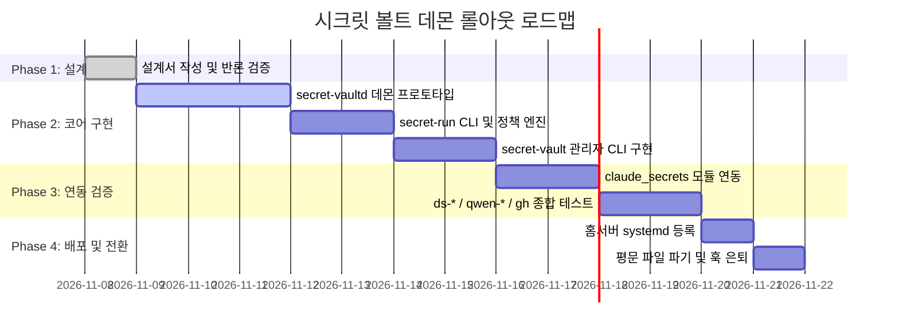

# 제14장: 단계별 구현 및 롤아웃 로드맵

---

| 단계 | 작업 내용 | 검증 기준 |
| :--- | :--- | :--- |
| **Phase 1** | 설계서 확정 및 출판 | `the-art-of-secret-defense.md` 완료 (현재 단계) |
| **Phase 2** | 홈서버 데몬 및 러너 구현 | UDS 통신, Keyring 연동, `/dev/shm` RAMFS 생성/파기 단위 테스트 |
| **Phase 3** | 관리자 CLI 및 메타데이터 구축 | `secret-vault set`으로 키 등록 확인, 누락 키 안내 카드 출력 검증 |
| **Phase 4** | 홈서버 배포 및 훅 은퇴 | `systemd --user` 등록, 평문 파일 삭제, `secrets-guard.py` 오탐 해소 |
