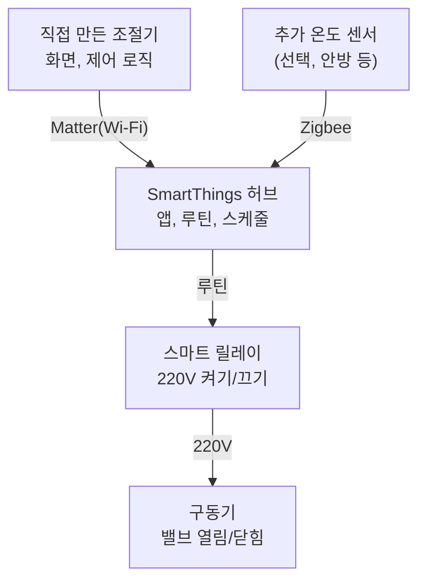
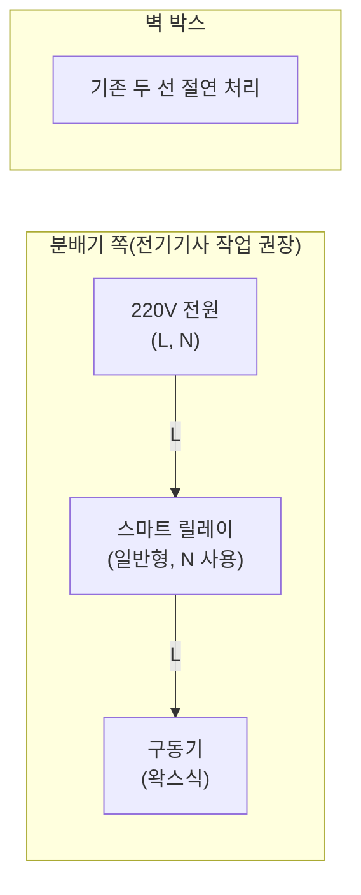

# 3장 0 아니면 100: 왁스 구동기와 220V를 누가 만지나

## 3.1 왁스 구동기는 아날로그일까

배선도를 받고 나서 구동기 자체가 궁금해졌다.

> **질문 노트** — "그리고 왁스 방식 구동기는 아날로그야? 아님 100퍼 개방 0퍼 폐쇄 만 돼?"

사실상 **0% 아니면 100%**다(**문헌 기반**).

- 전원이 들어오면 안의 왁스가 데워져 팽창하면서 몇 분에 걸쳐 밸브를 끝까지 연다
- 전원이 끊기면 왁스가 식으면서 스프링이 다시 닫는다
- 여닫는 도중 중간 위치를 지나가긴 하지만, 거기서 멈추게 만든 부품이 아니다
- 0~10V로 비례 제어하는 구동기도 따로 있지만, 아파트에 흔한 220V 2선식은 켜짐/꺼짐 전용이다

## 3.2 아날로그는 시간으로 흉내 낸다

그래도 아날로그처럼 쓸 방법은 있다. **시간 비례 제어**다. 예를 들어 20분 주기 중 몇 분을 켤지 조절해서 평균 열량을 바꾼다. 바닥난방은 반응이 워낙 느려서, 온도가 경계를 넘을 때마다 켜고 끄는 히스테리시스보다 이 방식이 온도를 더 고르게 유지한다.

추천받은 순서는 이렇다. 1단계는 히스테리시스로 만들고, 나중에 시간 비례 제어로 바꾼다. 그래서 제어 로직은 처음부터 **전략을 갈아 끼울 수 있게** 짠다(6장).

> **웹 개발자 시선** — 시간 비례 제어는 PWM이고, 웹으로 치면 "1분에 N번만 보내기" 같은 듀티 사이클 스로틀링이다. 켜짐/꺼짐만 되는 출력으로 평균값을 만든다.

## 3.3 구성도와 첫 그림

이 시점의 구성은 이랬다(A안 기준). 직접 만든 조절기는 판단만 하고, 실제로 릴레이를 켜는 건 SmartThings 허브의 **루틴**이다. 예를 들어 "온도조절기 상태가 난방 중이면 릴레이 켜기" 같은 규칙이다.

이 그림에서 중요한 결론이 하나 나왔다. **허브가 멈추면 난방도 멈춘다.** 그래서 최대 가동 시간이나 수동 버튼 같은 안전장치가 필요하다. 이 이야기는 9장의 데드맨 스위치로 이어진다.

## 3.4 릴레이를 고르는 기준

> "스마트 릴레이 고르는 기준을 정리해줘"

우선순위 순서로 받았다.

| 순서 | 기준 | 이유 |
|---|---|---|
| 1 | 무중성선 지원(A안) | 벽 박스에 N선이 없다. B안이면 일반 제품도 된다 |
| 2 | 최소 부하 ≤ 구동기 소비전력 | 무중성선 제품에서 가장 중요. 모자라면 제조사의 바이패스 부품 |
| 3 | KC 인증 | 220V 직결 기기 |
| 4 | SmartThings 호환 | 공식 지원 목록이나 커뮤니티 드라이버 |
| 통신 | Zigbee 또는 Matter | 허브와 로컬 통신. 제조사 클라우드를 거치는 Wi-Fi 제품은 지연과 서비스 종료 위험 |
| 안전 | 정전 후 복구 동작, 자동 꺼짐 타이머, 물리 버튼 | 난방이라 장애 때 어떻게 되는지가 중요 |

## 3.5 B안, 그리고 "A안도 220V잖아"

> "B안도 보여줄래?"

B안은 릴레이가 분배기 쪽 전원선 사이에 직접 들어간다.

N선이 있으니 최소 부하나 누설 전류 걱정이 없고, 제품 선택지도 넓다. 대신 분배기 주변은 결로와 누수 위험이 있으니 릴레이는 정션박스에 넣어 배관보다 높이 고정하고, 싱크대 수납장 안은 무선 신호가 약할 수 있다.

여기서 필자가 Claude의 표현 하나를 되물었다. Claude는 A안을 "직접 할 수 있는 범위"라고 했었다.

> **질문 노트** — "근데 A안도 220v를 다뤄야하는건 똑같지 않아?"

맞다는 답이 돌아왔다. 둘 다 220V 작업이다. "직접 할 수 있는 범위"는 위험이 없다는 뜻이 아니라 **작업 난이도**의 차이였다고 정정했다.

| | A안 | B안 |
|---|---|---|
| 작업 | 같은 선 두 가닥을 릴레이 단자에 옮겨 꽂는 교체 | 기존 배선을 자르고 새로 잇기. N선도 연결 |
| 새 접속점 | 없음 | 여러 개 |
| 장소 | 벽 박스 | 습기가 있는 분배기 근처 |

필자는 한 번 더 물었다.

> "B도 빼고 연결한다는 점에서 비슷해보여서"

분배기 쪽에 단자대나 커넥터가 이미 있다면 B안도 결국 "빼서 다시 꽂기"라는 답이었다. 차이는 N선 하나 더 따오기와 케이스 고정뿐이다. 그렇다면 최소 부하 걱정이 없는 B안이 오히려 낫다. 결국 판단 기준은 **분배기 쪽에서 선이 어떻게 이어져 있느냐**였다. 이 질문의 답은 11장에서 나온다.

공통 수칙도 이때 정리했다.

- 차단기를 내린 뒤 **검전기로 정말 끊겼는지 확인**한다. 차단기 표시가 틀린 경우가 꽤 있다
- 단자에 선을 끝까지 넣고 조인 뒤 당겨서 빠지지 않는지 확인한다
- 자신이 없으면 A안도 전기기사에게 맡긴다

## 알게 된 점

- 아파트의 220V 2선식 왁스 구동기는 켜짐/꺼짐 전용이다. 중간값은 시간 비례 제어로 흉내 낸다.
- 판단은 직접 만든 조절기가 해도, 실제로 켜는 건 허브의 루틴이다. 허브는 단일 장애점이 된다.
- "안전하다"와 "쉽다"는 다르다. AI가 "직접 할 수 있다"고 하면 어떤 의미인지 되묻는다.
