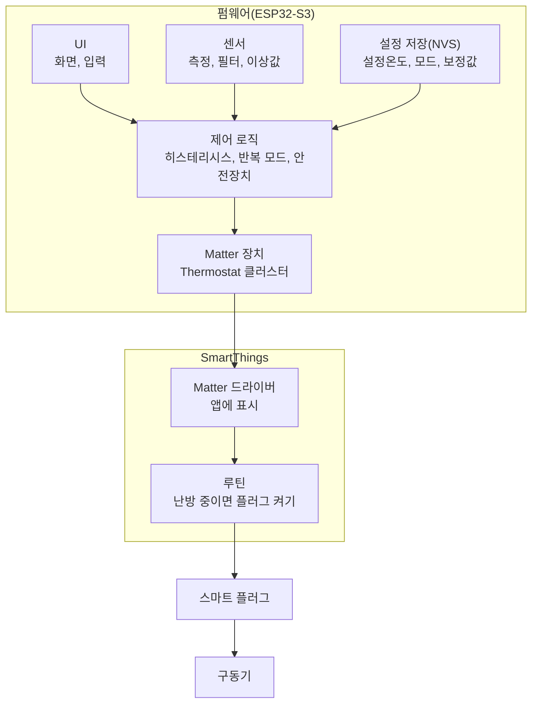

# 6장 판단은 기기가, 전달은 루틴이

## 6.1 컴포넌트 관점으로 보기

> "좋아 그럼 하드웨어는 이정도로 될거같고.
> 소프트웨어 쪽 볼까.?
>
> 그전에 각 컴포넌트 관점의 설계도 보여줘"

펌웨어, SmartThings, 스마트 플러그로 나눠 각자 맡는 역할을 그렸다.



## 6.2 설계 원칙: 판단은 기기가

핵심 원칙은 한 줄이다. **판단은 펌웨어가 하고, SmartThings는 전달만 한다.**

- 조절기가 온도를 재고 "지금 난방이 필요한지"를 스스로 판단한다.
- 그 결과를 Matter 온도조절기의 **작동 상태**(ThermostatRunningState: 난방 중/대기)로 알린다.
- SmartThings 루틴은 그 상태를 보고 플러그를 켜고 끄기만 한다.

핵심 로직이 전부 펌웨어 안에 있으니 테스트하기 쉽고, 나중에 시간 비례 제어로 바꾸기도 쉽다.

> **웹 개발자 시선** — 비즈니스 로직은 서버(펌웨어)에 두고, 워크플로 엔진(루틴)은 "상태가 바뀌면 이걸 호출"만 한다. 로직이 노코드 자동화 도구 안에 흩어지면 테스트할 방법이 없다.

### 먼저 확인할 위험

이 원칙에는 전제가 하나 있다. **SmartThings 루틴이 Matter 온도조절기의 작동 상태를 조건으로 쓸 수 있어야 한다.** 이건 **확인 필요**다. 안 된다면 조절기에 "난방 요청"용 보조 엔드포인트(켜짐/꺼짐 센서 등)를 하나 더 만들어 루틴 조건으로 쓴다. 그래서 소프트웨어는 **Matter 등록과 루틴 연동 시험부터** 시작하기로 했다.

## 6.3 표준에 있는 것

> **질문 노트** — "온도조절기 표준에는 어떤 설정들이있어?"

Matter 온도조절기 표준(Thermostat 클러스터)의 주요 항목이다(**문헌 기반**).

| 묶음 | 항목 |
|---|---|
| 기본 | 현재 온도, 난방/냉방 설정온도, 운전 모드(꺼짐·난방·냉방·자동), 작동 상태(읽기 전용), 설정온도 한계 |
| 선택 | 온도 보정, 재실/부재 설정온도, 주간 스케줄, 프리셋(집·외출·취침 등, 최신 버전), 난방 요구량(%) |
| 보조 클러스터 | UI 설정(섭씨/화씨, 버튼 잠금) |

표준에 있다고 SmartThings 앱에 다 보이는 건 아니다. 확실히 쓸 수 있는 건 **현재 온도, 설정온도, 모드, 작동 상태** 정도로 봤다(**추정**, 첫 시험에서 확인).

> **웹 개발자 시선** — OpenAPI 스펙에 있는 필드와 실제 프런트엔드가 그려 주는 필드는 다르다. 스펙만 보고 기능을 약속하지 않는다.

이 프로젝트의 매핑은 이렇게 정했다. 존(구역)마다 Thermostat 엔드포인트 하나, 난방 전용이다.

| Matter 항목 | 이 프로젝트에서 |
|---|---|
| LocalTemperature | 지금 쓰고 있는 센서의 온도 |
| OccupiedHeatingSetpoint | 목표온도. 앱과 화면 양방향 동기화 |
| SystemMode | Off / Heat (Heat = 온도 모드 또는 반복 모드) |
| ThermostatRunningState | 펌웨어가 판단한 난방 요청 → 루틴 조건 |
| 설정온도 한계 | 예: 5~30℃ |

## 6.4 모듈 구조

개발 환경은 **Arduino ESP32 코어 3.x + 내장 Matter 라이브러리**로 정했다. 빌드는 Arduino CLI나 PlatformIO처럼 터미널에서 빌드하고 올릴 수 있는 쪽이어야 Claude Code가 직접 돌릴 수 있다.

```text
src/
  core/      제어 로직. 하드웨어 의존성 없는 순수 C++. PC에서 단위 테스트
  matter/    Thermostat 엔드포인트, 속성 동기화
  sensor/    로컬 센서(SHT40), 원격 센서(HTTP), 필터링, 이상값 감지, 센서 선택
  storage/   NVS 설정 저장
  net/       Wi-Fi, NTP 시간 동기화, 홈서버 HTTP 클라이언트
  ui/        보드별 구현(waveshare43b/, 나중에 m5dial/)
test/        core/ 단위 테스트(호스트 빌드)
```

`core/`는 시간과 온도를 입력으로 받아 "난방 요청 여부"를 내놓는 상태 머신이다. `millis()` 같은 하드웨어 호출을 직접 쓰지 않고 시간을 **주입받는다.** 그래서 PC에서 "60분이 지났다"를 1밀리초 만에 시험할 수 있다.

> **웹 개발자 시선** — `core/`를 하드웨어 없이 PC에서 테스트하는 건 도메인 로직을 프레임워크에서 떼어 내는 헥사고날 구조다. 보드는 어댑터일 뿐이다. 시간 주입은 테스트에서 `Date.now()`를 가짜 시계로 바꾸는 것과 같다.

## 6.5 처음부터 다중 존

> "그리고 이건 향후 계획인데,
> 방 마다 구동기를 개별로 달면 컨트롤러가 방마다 컨트롤 할수도있지?"

된다. 분배기에는 보통 방마다 배관 루프가 따로 있어서, 루프 밸브마다 구동기를 달면 된다(설치는 난방 업체). 켜고 끄는 쪽은 구마다 따로 제어되는 스마트 멀티탭으로, 방별 센서는 이미 홈서버로 받는 구조(8장)를 그대로 쓴다. Matter에서는 **방마다 온도조절기 엔드포인트를 하나씩** 두면 SmartThings에 방별 온도조절기로 보인다.

그래서 결정했다. 제어 로직을 처음부터 **"존 1개짜리 다중 존 구조"**로 짠다. 존마다 설정온도, 모드, 센서 선택, Matter 엔드포인트가 하나씩 있다.

> **웹 개발자 시선** — 테넌트가 하나뿐일 때도 `tenant_id`를 넣어 두는 것과 같다. 지금 드는 비용은 거의 없고, 나중에 스키마를 뜯어고칠 일을 없앤다. 단, 실제로 늘어날 계획이 있을 때만 정당하다.

## 6.6 개발 순서

1. **Matter 뼈대:** 가짜 온도로 등록하고, 앱에 보이는 항목과 루틴 조건을 확인한다(가장 큰 위험부터)
2. **제어 로직:** PC 단위 테스트로 완성
3. **센서:** SHT40과 홈서버 원격 센서
4. **스마트 플러그 연동:** 루틴으로 실제 난방
5. **터치 UI:** LVGL
6. **설정 저장과 다듬기**
7. **확장:** M5Dial, Edge 드라이버(7장), 다중 존, 시간 비례 제어

> **웹 개발자 시선** — "가장 큰 위험부터"는 스파이크다. 화면을 예쁘게 만들기 전에 외부 플랫폼 연동이 되는지부터 찔러 본다.

이 순서는 10장에서 "동시에 할 수 있는 일감"으로 다시 짜인다.

## 알게 된 점

- 판단은 기기에, 자동화 플랫폼에는 전달만 맡긴다. 로직이 한곳에 있어야 테스트할 수 있다.
- 그 원칙이 성립하는지(루틴이 작동 상태를 조건으로 쓸 수 있는지)부터 확인한다.
- 시간을 주입받는 순수 로직은 하드웨어 없이 PC에서 몇 시간짜리 시나리오를 순식간에 돌려 볼 수 있다.
