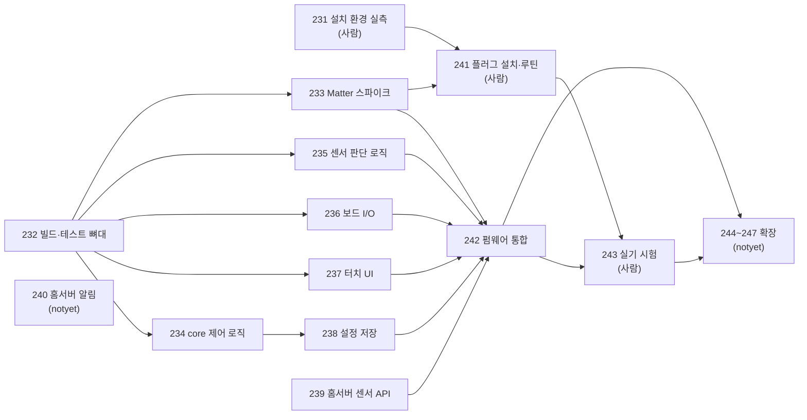

# 10장 줄 세우기에서 동시에 달리기로: 일감 그래프

## 10.1 대화를 레포로

설계 대화가 끝나자 필자는 Claude 앱에 대화 전체를 원문 그대로 뽑아 달라고 했다.

> "스토리형이 좋아. 그리고 이걸 보고 클로드 코드가 github page에 맞게 한번더 가공할꺼야.
> 가능하면 원문 그대로를 뽑았으면 해"

그 원문을 빈 레포(`thermostat-esp32`)를 연 Claude Code에 붙여 넣었다.

> "이걸로도 github page에 새 책을 만들려고 하는데, 집필노트 작성해줄래? 기존 책들과 비슷한 서술방식이면 좋을것 같고, 관점은 IoT를 위해 임베디드에 입문한 웹 개발자의 토이프로젝트 개발기 관점이야"

레포의 첫 파일은 코드가 아니라 **집필 노트**(`docs/journal/2026-11-24-...md`)였다. 사용자 발언은 원문 그대로, AI의 답은 요약으로, 책에 쓸 재료(질문 노트, 비유 후보, 교훈)는 따로 상자에 담았다. 지금 읽고 있는 이 책이 그 노트에서 나왔다.

이어서 Claude 앱에서 따로 정리한 개발 기준 문서를 붙여 넣었다.

> "그리고 이건 개발을 위해 정리한건데, 일감화 해줄래?"

일감 본문이 가리킬 문서가 레포에 있어야 하니, 그 내용을 `CLAUDE.md`로 저장했다.

## 10.2 공개 레포에 무엇을 올리나

레포가 공개(PUBLIC)라서 커밋 전에 생활 정보가 들어 있다고 알렸다. 필자의 답은 두 가지였다.

> "조금 더 마스킹 하고 커밋.
> [지역] 구축 아파트 > 구축 아파트
> [허브 기기]허브 > 허브
>
> 처럼"

> "사람들이 따라할수 있도록 만든거라. esp32 기기정보는 구체적으로 표현해도 좋아."

원칙이 하나 생겼다. **따라 할 수 있는 정보는 구체적으로, 나를 특정하는 정보는 가린다.** 이 책의 서문에 적은 원칙이 여기서 나왔다.

> **웹 개발자 시선** — 공개 저장소에 `.env`를 올리지 않는 것과 같다. 다만 여기서 가릴 것은 비밀번호가 아니라 생활 정보다.

## 10.3 첫 그래프: 한 줄로 선 일감

처음 그린 일감 그래프는 6장의 개발 순서를 거의 그대로 따랐다. 일감 12개가 뼈대 → Matter·core·센서 → 원격 센서 → 통합 → 플러그 → UI → 저장으로 길게 줄을 섰다. UI는 통합이 끝나야 시작할 수 있었고, 저장은 UI가 끝나야 시작할 수 있었다.

등록 승인을 묻자 필자가 답했다.

> **질문 노트** — "좀더 동시에 진행할수있도록 일감 설계해볼래?"

## 10.4 다시 짠 원칙

| 원칙 | 무엇이 달라졌나 |
|---|---|
| 순수 로직과 보드 I/O를 나눈다 | `core`와 센서 판단 로직은 PC에서 개발·테스트. SHT40, NTP·RTC, HTTP 클라이언트는 따로 |
| UI는 가짜 상태로 먼저 | 통합을 기다리지 않는다 |
| 뼈대는 작게, 대신 모듈별 진입점 | 병렬 일감이 같은 `main`과 빌드 설정을 고치다 충돌하지 않게 |
| 사람 일은 일찍 | 플러그 설치와 루틴 구성은 Matter 스파이크만 끝나면 시작 |
| 실기 시험은 맨 끝 | 실제 난방은 모든 것이 모인 뒤 |
| 홈서버 일은 독립 | 센서 API와 알림은 펌웨어와 무관하게 처음부터 |

그리고 확장 일감도 붙였다.

> "확장 일감도 추가"

M5Dial 포팅, Edge 드라이버, 다중 존, 시간 비례 제어 넷은 아직 시작할 때가 아니라는 표시(`notyet`)를 달아 함께 등록했다.

## 10.5 등록한 그래프

일감 17개, 차단 링크 20개다. 화살표는 "앞 일감이 끝나야 뒤 일감을 시작할 수 있다"는 뜻이고, **다른 일감의 결과물을 직접 써야 할 때만** 그었다.

- 처음부터 시작할 수 있는 일감: 실측(231), 뼈대(232), 홈서버 API(239)
- 뼈대가 끝나면 다섯 일감(233~237)이 **동시에** 열린다
- 가장 긴 경로: 뼈대 → core → 설정 저장 → 통합 → 실기 시험

이 과정에서 9장의 빈틈(반복 모드 60분 중 60분)도 찾았다. 대화로는 넘어갔던 경계값이, 일감 본문에 완료 기준을 적으려니 보였다.

> **웹 개발자 시선** — 프런트엔드는 목(mock) API로, 백엔드는 API 계약만 보고 동시에 개발하는 것과 같다. 임베디드에서도 통했다. 화면은 가짜 상태로, 로직은 PC 테스트로, 통합은 마지막에 한다. "모듈별 데모 진입점"은 모노레포에서 패키지마다 따로 띄우는 Storybook이나 개발 서버와 같다.

### 작은 삽질

마스킹을 적용하던 명령 앞에 쓸데없는 `cat >`가 붙어 있어서, 셸이 입력을 기다리며 2분 동안 멈췄다. 중지하고 스크립트를 파일로 만들어 다시 돌렸다. AI도 이런 실수를 한다.

## 알게 된 점

- 일감 그래프는 개발 순서표가 아니다. "무엇이 무엇의 결과물을 직접 써야 하는가"만 화살표로 남기면 동시에 할 수 있는 일이 보인다.
- 하드웨어 프로젝트에서도 순수 로직을 떼어 내면 보드 없이 진행할 수 있는 일이 크게 늘어난다.
- 공개 레포에 올릴 때는 "따라 할 정보"와 "나를 드러내는 정보"를 나눈다.
- 실측 일감을 그래프의 맨 앞(루트)에 둔 이유는 다음 장에서 바로 드러난다.
